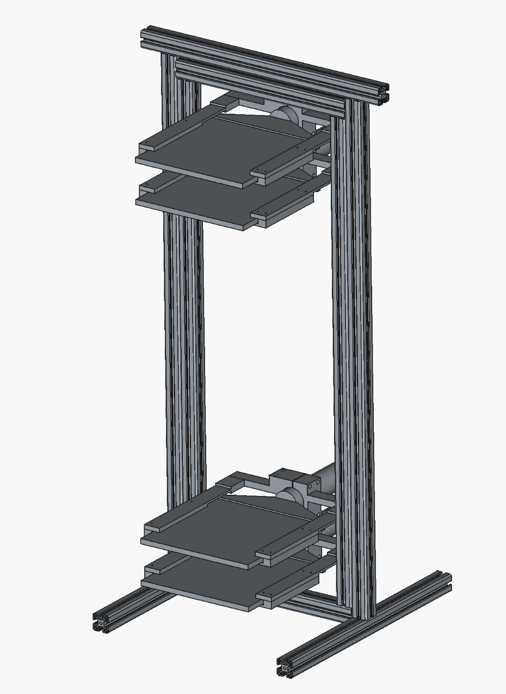
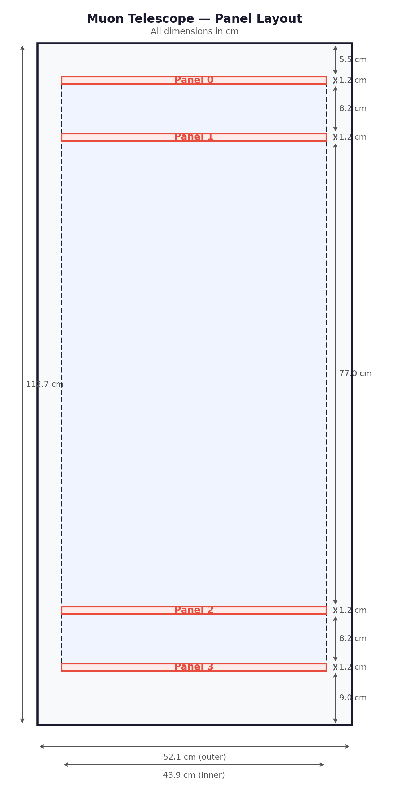
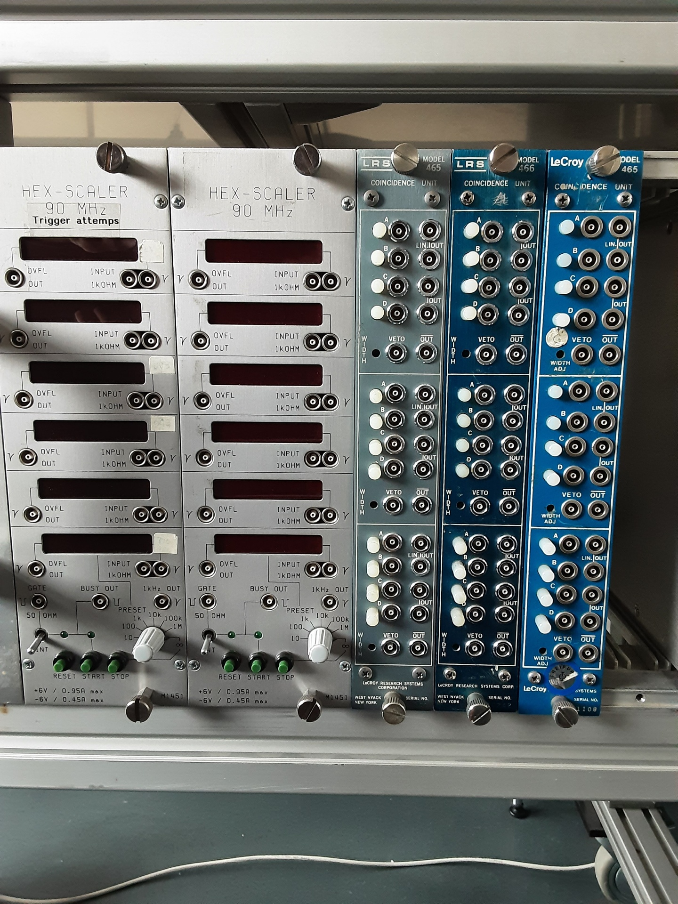
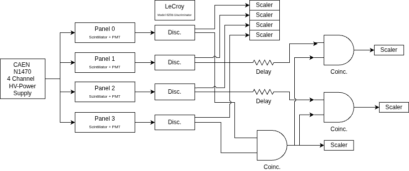
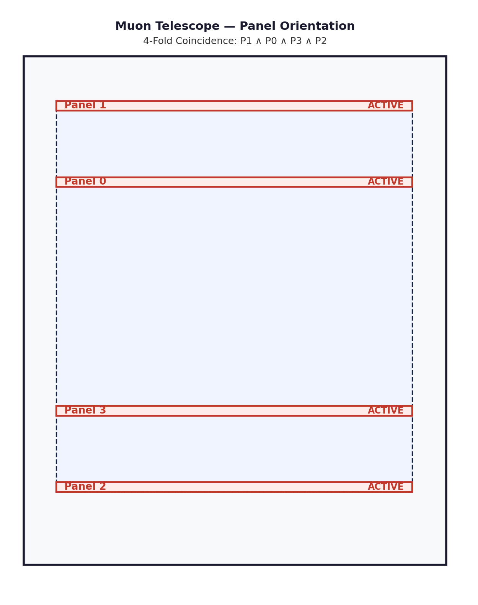
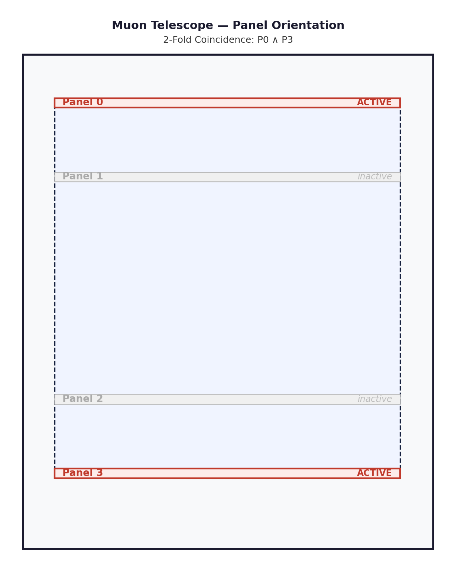
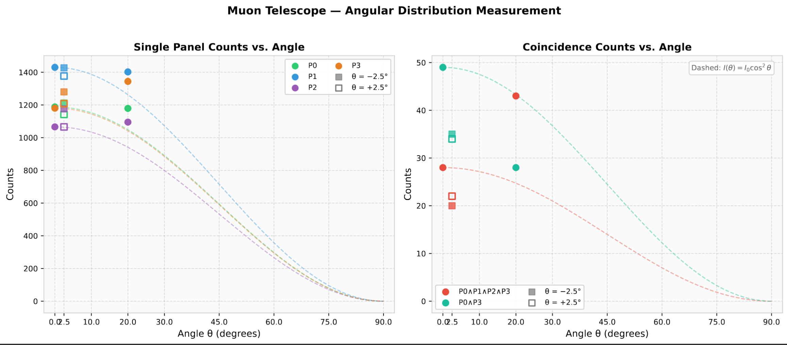

# Telescope

## Overview

Muon Telescope V2 is based on the first version of the instrument. The key upgrade is the move from a two-panel to a four-panel configuration, which enables track reconstruction, better coincidence conditions, and operation as two independent sub-telescopes.

## Detector configuration

Four plastic scintillation panels, stacked vertically from top to bottom:

- Panel 0 (topmost)
- Panel 1
- Panel 2
- Panel 3 (bottommost)

### Panel specifications

- Active area: 282 mm × 282 mm = 0.0795 m² per panel
- Scintillator thickness: 10 mm
- Material: EJ-200 plastic scintillator (Eljen Technology)
- Readout: Hamamatsu PMT
- Manufacturer: Scionix Holland

| Specification | Panel 0 | Panel 1 | Panel 2 | Panel 3 |
|---|---|---|---|---|
| Model | R280x10B280/2M-EI-P-X-NEG | same | same | same |
| Scintillator | EJ-200 | EJ-200 | EJ-200 | EJ-200 |
| Serial no. | S2AA6047 | S2AA6049 | S2AA6050 | S2AA6048 |
| Type | Neg-Scintillator-Det | same | same | same |

### Panel voltages

Each panel has a maximum operating voltage suggested by the manufacturer. The working voltages were set conservatively below it for stable long-term operation and to protect the PMTs. These values are set on the N1470's **front panel** — the software only reads them back (see [High voltage](../software/hv.html)).

| Setting | Panel 0 | Panel 1 | Panel 2 | Panel 3 |
|---|---|---|---|---|
| Suggested max voltage | 1560 V | 1800 V | 1340 V | 1550 V |
| Set max voltage limit | 1460 V | 1700 V | 1240 V | 1450 V |
| Working voltage (V_set) | 1400 V | 1600 V | 1150 V | 1350 V |

## Signal chain

PMT pulses go into a discriminator, which turns them into logic pulses; a coincidence unit combines the panels; the result is stretched to a ~1 ms gate by a Model 222 gate generator and fed to the control board, where an inverting transistor stage presents it to a Raspberry Pi GPIO. The Pi counts falling edges (see [Data formats](../software/data-format.html) for what it records).

- Discriminator: LeCroy Model 623B

## Panel orientation options

The panels can be combined in several ways; the drawings below show the "all four active" and "P0 with P3" configurations.

## First test, 100 s per point

Singles per panel, the four-fold coincidence (P_all) and the P0·P3 coincidence, 100 s each:

| Counts / angle | θ = 0° | θ = −2.5° | θ = +2.5° | θ = 20° | θ = 45° |
|---|---|---|---|---|---|
| P0 | 1188 | 1212 | 1142 | 1179 | — |
| P1 | 1430 | 1427 | 1377 | 1402 | — |
| P2 | 1066 | 1176 | 1066 | 1095 | — |
| P3 | 1180 | 1280 | 1208 | 1344 | — |
| P_all | 28 | 20 | 22 | 43 | — |
| P03 | 49 | 35 | 34 | 28 | — |

The KiCad board designs, CAD files and the original drawings live under `hardware/` in the repository.
