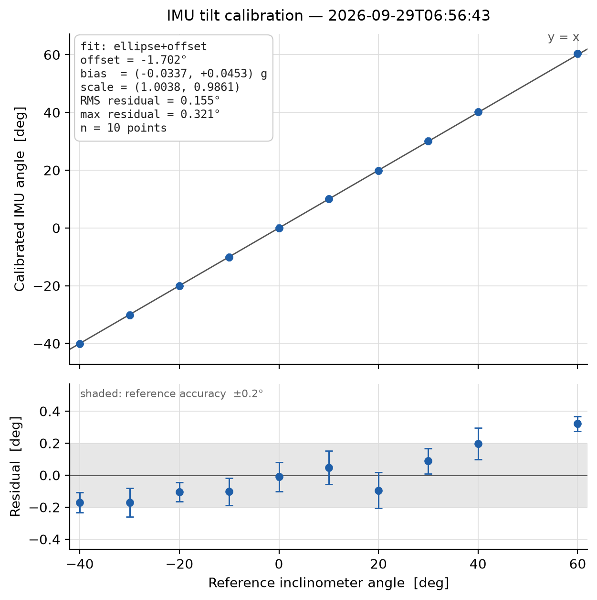

# IMU calibration

The IMU (BMI160) is mounted on the moving assembly and is the telescope's **absolute angle reference**: there is no homing switch, the step counter is seeded from it at startup and after every move, and the angle written into every data file is the one it measures. Its accuracy is therefore the accuracy of the dataset's angle axis.

## What is measured

Held still, the accelerometer sees only gravity. The tilt is

```
raw_tilt = atan2(ay, az)        (degrees)
```

A real sensor adds a bias and a gain error to each axis, and the IMU is never mounted perfectly parallel to the telescope. Two corrections follow:

1. **Ellipse** — bias and scale per axis. Readings at many angles should lie on the unit circle `ay² + az² = 1 g`; they actually trace an ellipse `((ay − b_y)/s_y)² + ((az − b_z)/s_z)² = 1`. Writing the ellipse as a conic with the `ay²` coefficient fixed at 1 makes this an ordinary linear least-squares problem (four unknowns, so at least four points, spread over a wide range of angles). The fit is solved in plain Python; no NumPy.
2. **Mounting offset** — a single number, `offset = mean(corrected_tilt − reference)`.

The calibration screen fits both and keeps the ellipse only if it clearly helps (worst residual less than half the offset-only worst residual); otherwise a noisy point set would buy four parameters that describe nothing but the noise.

On this build the ellipse took the worst residual over nine bench points from **2.03° to 0.24°**, and the dominant error turned out to be bias (−0.034 g, +0.032 g), not scale (0.6 % apart).

## Procedure

You need an external inclinometer; a Bosch digital level with ±0.2° catalogue accuracy is used here (`[imu] reference_accuracy_deg`).

1. TUI → `c` Calibrate → **IMU calibration**.
2. Move the telescope to an angle (the Move field, or by hand with the motor toggle off), read the reference instrument, type its value, press **Capture**. The daemon averages the IMU for 10 s — keep still.
3. Repeat at 6–10 angles spread over the working range, including both ends. Points bunched in one corner fit an ellipse through that corner and say nothing about the rest.
4. The table shows each point's residual as it updates. Press **Fit & save**.

The daemon stores the result in `imu_calibration.json`, writes a timestamped record under `data_dir/imu_calibration/`, and draws it in a separate process (so matplotlib's first import can never stall the daemon):



The upper panel is the calibrated IMU angle against the reference with the `y = x` line. The lower panel carries the argument: residuals with error bars, and the reference instrument's own ±0.2° band shaded. A residual inside the band is a difference the reference cannot resolve; a trend across angles that one offset cannot flatten is what the ellipse exists to remove.

Error bars are measured, not assumed: vertical is the standard error of the IMU mean over its averaging window (`σ/√n`, from the scatter of the samples); horizontal is the reference accuracy.

Re-draw any past record, e.g. for a thesis figure, without repeating the measurement:

```bash
python scripts/plot_imu_calibration.py --latest /home/muon_telescope/muon_data/imu_calibration
python scripts/plot_imu_calibration.py muon_data/imu_calibration/imu_cal_2026-10-04T14-03-22Z.txt
```

## What the angle uncertainty means for the physics

For a `cos²θ` zenith distribution, a 0.5° angle error propagates to 0 % at θ = 0, ~1.75 % at 45° and ~10 % at 80°. The calibration's job is to keep the angle axis well inside that: with the ellipse fit the residuals sit at the level of the reference instrument itself.

## Re-calibration

The screen always samples the **uncorrected** tilt, so a new calibration never folds the old one into itself — you can recalibrate as often as you like. Keep the old records: comparing them over months is how you find out whether the mounting has shifted.
